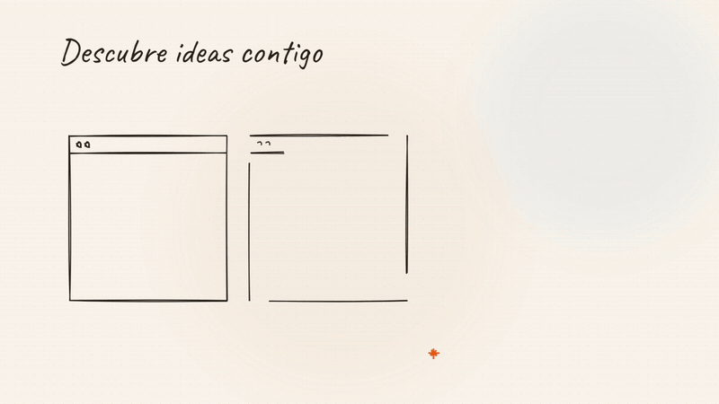

# 🎨 AI Frontend Guide Kit

🌐 **English** · [Español](README.es.md)

**Reuse-first UI catalog + guided workflow for AI agents building frontends.**
This repository is both the 🏭 **factory** (extraction pipeline + catalog) and the 📦 **distributable kit** you drop into any frontend project.

## 🎬 Presentation — 55 seconds

<p align="center">
  <a href="media/explainer/video/ai-frontend-guide-kit-es.mp4">
    
  </a>
</p>

<p align="center">
  <b>Reuse-first catalog, interactive reference discovery (example sites, likes, screenshots), the three phases and the selection memory — with friendly voice-over.</b><br><br>
  ▶️ <a href="media/explainer/video/ai-frontend-guide-kit-es.mp4">Español</a> ·
  <a href="media/explainer/video/ai-frontend-guide-kit-en.mp4">English</a> ·
  🖋 <a href="media/explainer/guion.md">Storyboard</a> ·
  🎛 <a href="media/explainer/index.html">Animation source</a>
</p>

## ✨ What's inside

| | What | Details |
|---|---|---|
| 📚 | **Catalog** | 34 verified sources · 4,287 reusable entries · 21 categories · quality score, per-entry licenses and install commands · React, Vue and Svelte · offline `explorer.html` |
| 🧭 | **Guided kit** (`ai-frontend-guide-kit/`) | `AGENTS.md` + router + 3-phase workflow in short guides (00–13) + `find`/`get` query tools. Self-contained: no build, no npm dependencies |
| 🧠 | **Agent skills** | `ai-frontend-guide` (workflow), `frontend-polish` (phase 3), `frontend-refactor` (FSD, only on request), `ux-map` (visual screen map) and 16 vendored UX skills (`userflow` + 15 `flow-*`, MIT) |
| 🧭 | **Design flow** | `flow.mjs` keeps the route and current step per project and refuses skipped steps; `guides/FLOWS.md` lists every route |
| 💾 | **Selection memory** | `ai-frontend-output/`: append-only decision history, styles/components summary, reusable combinations and the UI libraries in use or to research |
| 🛡️ | **Audits** | `audit-honesty` (deceptive patterns), `audit-a11y` (axe + WCAG 2.2), `audit-perf` (Lighthouse vs Core Web Vitals) in `ai-frontend-guide-kit/tools/` |
| 🔒 | **Laya (optional)** | Local decision engine that ranks catalog candidates with calibrated probabilities — everything runs on your PC |

## 🔄 The three-phase workflow

| Phase | What happens | You get |
|---|---|---|
| **1 · 🧠 UX & theory** | Experience direction (`experience/` + Laya for questions/direction), interactive discovery loop (example sites, likes, screenshots, component combinations), `landing-page-design` for landing pages, then proven flows (`userflow` + `flow-*`) and design tokens | `EXPERIENCE-BRIEF.md` · `PRODUCT.md` · `UX-SPEC.md` · `flow-report.html` · `ux-map.excalidraw` · `DESIGN.md` + theme |
| **2 · 🧩 Composition** | Inventory → catalog search → reuse/adapt/build decision → install. Only what the catalog cannot provide is built, with `hallmark` or `design-taste-frontend` | Components adapted to your tokens |
| **3 · ✨ Total polish** | External audits (`impeccable`, `hallmark`, emilkowalski) + Playwright MCP loop + `@playwright/test` regression | A screen ready to ship |

> 🔀 The phases are **entry points, not a strict pipeline**: the agent asks what you want — new frontend, small change, custom addition, polish only, UX only — and enters exactly where it fits.

## 🚀 Quickstart

### Option A · as a dependency (recommended)

```bash
npm i -D github:urben88/ai-frontend-guide-kit    # pin a version if you want: #v1.2.0
npx ai-frontend-guide-kit                        # explicit, idempotent setup
```

Optional: add `"kit": "ai-frontend-guide-kit"` to your scripts and run `npm run kit` after updating.
There is **no `postinstall`** — plain `npm install` never mutates your project.

### Option B · one-shot (no dependency)

```bash
npx github:urben88/ai-frontend-guide-kit
```

### 🎛️ Flags

| Flag | Effect |
|---|---|
| `--no-skills` | kit + docs only, no skills at all |
| `--no-design-skills` | skip the 5 external design skill repos (impeccable/taste-skill/emilkowalski/hallmark/landing-page-design) |
| `--no-mcp` | skip the Playwright + Excalidraw MCP configuration |
| `--with-laya` | also install/update Laya |
| `--target <dir>` | install into another folder |
| `--skills-mode cli` | legacy full CLI flow (lockfile + multi-agent links) |

### 📦 Offline / no git

```bash
npm pack                                  # -> ai-frontend-guide-kit-1.2.0.tgz (~0.3 MB, includes skills)
npx ./ai-frontend-guide-kit-1.2.0.tgz     # run it in the destination project
```

Then tell your agent:

> *"Read `ai-frontend-guide-kit/AGENTS.md` and follow its workflow."*

## 🗺️ Frontend map (always on)

The installer scans the project and keeps `ai-frontend-output/UI-MAP.md`, `ui-map.json` and `ui-history.jsonl` (components, users, routes, visual roles, strays, unresolved imports, history of components added and removed). It never edits your source.

```bash
node ai-frontend-guide-kit/tools/ui-map.mjs impact loading      # what must change: owner, users, routes, strays
node ai-frontend-guide-kit/tools/ui-map.mjs have "data table"   # check before creating
```

## 🧩 Pieces: a shared Lego library

Reusable components (micro to large, with variants as props) live in one library shared by all your projects (`~/.ai-frontend-guide-kit/pieces/`). Each project keeps only its personality and usage in `ai-frontend-output/pieces.json`. The agent searches before it builds (own piece, new variant, catalog, new piece), polishes the same piece when you ask for changes, and records use, versions and likes on its own. Files are the source of truth; a SQLite FTS5 index with SHA-256 hashes keeps it fast as it grows (without `node:sqlite` it scans the files).

```bash
node ai-frontend-guide-kit/tools/pieces.mjs find "pricing table"   # before creating
node ai-frontend-guide-kit/tools/pieces.mjs list --liked           # what you like, ranked
```

## 🧭 Design flow: one route, no skipped steps

**In one sentence:** the kit remembers, inside your project, which design route you are on and which step comes next, and it does not let the agent jump ahead.

Why it matters: when several people (or several chats) work on the design, each one used to start from scratch or skip the boring parts. Now the route is a file in the project (`ai-frontend-output/flow-state.json`), so everyone continues at the same step.

| Command | What it does |
|---|---|
| `flow.mjs status` | Is the kit installed? Which route and step are active? What has been recorded? |
| `flow.mjs list` | Every route and its steps, with the guide and skill for each (same text as `guides/FLOWS.md`) |
| `flow.mjs start <route>` | Declares the route: `new`, `direction`, `ux`, `iterate`, `polish`, `redesign`, `visual-feedback`, `architecture` |
| `flow.mjs next` | Shows the current step: which guide to read, which skill to use, which file to produce |
| `flow.mjs done <step>` | Closes the step only if it is the current one **and** its file exists |

Three more helpers keep the agent's context small:

- **Project libraries:** `context.mjs` lists the UI libraries the project already uses (in the catalog, compatible, or to research) and `memory.mjs lib sync` saves them, so the agent reuses them instead of adding new ones.
- **Catalog digest:** `catalog/digest.md` gives the 5 best entries per category in about 2,500 tokens, a quick overview before searching.
- **Site scout:** paste the URL of a component site and `scout.mjs <url>` tells you whether the catalog already has it; with `--fetch` it summarizes that one page (components, install command, license hints).

## 💬 Example: "I want a landing page for my app"

You only talk to your agent. Behind the scenes it uses the kit like this:

```text
1. The agent checks where the project is
   $ node ai-frontend-guide-kit/tools/flow.mjs status
   Kit: installed
   Flow: none (declare the route with: node tools/flow.mjs start <route>)

2. It declares the route for a new frontend
   $ node ai-frontend-guide-kit/tools/flow.mjs start new
   Steps: intake → direction → ux → tokens → compose → polish
   Next step: intake — ask what we are doing, read the project context, declare the route

3. It tries to jump to the visual direction... and the kit says no
   $ node ai-frontend-guide-kit/tools/flow.mjs done direction
   flow: step "direction" is not the current step (current: intake); steps are never skipped

4. It does the intake properly (project context + frontend map), then closes the step
   $ node ai-frontend-guide-kit/tools/context.mjs
   $ node ai-frontend-guide-kit/tools/flow.mjs done intake
   Next step: direction — questions, archetype, philosophy, journey, three directions

5. You share a site you like: https://magicui.design/docs/components/marquee
   $ node ai-frontend-guide-kit/tools/scout.mjs https://magicui.design/docs/components/marquee
   In the catalog: `magicui` (Magic UI, 78 entries, MIT ...)
   Query it instead of reading the site: node tools/find.mjs --source magicui
```

It goes on like this, step by step, until `polish`. If you come back tomorrow, or a teammate opens another chat, `flow.mjs status` shows exactly where you left off.

## 🔎 Finding components

```bash
node ai-frontend-guide-kit/tools/find.mjs --text "pricing toggle" --stack react --licensed --min-quality 70
node ai-frontend-guide-kit/tools/find.mjs --category forms --stack vue            # Vue / Svelte ports included
node ai-frontend-guide-kit/tools/find.mjs --source reactaria --category forms       # accessible primitives
```

Results are ranked by **quality** (license clarity, install effort, dependency weight, source maintenance) or by weighted text relevance; near-identical entries across sources are collapsed (`--all` shows them) and icons are hidden unless asked. Open `ai-frontend-guide-kit/catalog/explorer.html` for an offline, filterable catalog with preview links and copy-install buttons.

## 🛠️ What the installer does

1. 📁 Copies `ai-frontend-guide-kit/` into the target project (removes the legacy `ai-frontend-guide/` if present).
2. 📌 Adds the **design routing block** to the project's `AGENTS.md` (and to `CLAUDE.md` / `.claude/CLAUDE.md` if they exist, because Claude Code then ignores `AGENTS.md`): any talk about design, UI or UX — in English or Spanish — goes through the kit first. The block is marked, so re-running the installer refreshes it without touching your own content.
3. 💾 Creates `ai-frontend-output/` (selection memory) if missing — never removed on refresh.
4. 🧩 Installs the **20 skills of this repo** into `.agents/skills/` (clean: no lockfile, no symlink sprawl) plus the **5 external design skill repos** via their CLI by default; the routing block gives each one its step in the flow. If the project has `.claude/`, the 20 are linked into `.claude/skills/`.
5. 🎭 Configures the **Playwright + Excalidraw MCP** servers per detected harness (`.mcp.json` for Claude Code, `opencode.json` for OpenCode) and creates the `ai-frontend-output/ux/ux-map.excalidraw` scaffold; otherwise prints the exact commands. Browser once: `npx playwright install chromium`.
   - 🖱️ **Optional — Agentation** (click an element in your React app and tell the agent exactly what to change; guide `11-VISUAL-FEEDBACK.md`). The installer only prints the message, it does not install it: `npm install agentation -D`, `claude mcp add agentation -- npx -y agentation-mcp server`, `npx agentation-mcp doctor`, and mount `<Agentation endpoint="http://localhost:4747" />` in dev only.
6. 🗺️ Scans the project with `ui-map` (always) and writes the frontend map under `ai-frontend-output/` (a failed scan only warns).
7. 🐍 Checks Python/Laya and prints the exact next step.

> 💡 External skills need network; if they fail the install continues and the kit still works with `find`/`get`.

## 💾 Selection memory (`ai-frontend-output/`)

Every component decision is recorded, so each project keeps an auditable history and reusable combinations:

```bash
node ai-frontend-guide-kit/tools/memory.mjs combo list       # check saved combinations before searching
node ai-frontend-guide-kit/tools/memory.mjs add --screen landing --block hero --need "..." \
  --decision reuse --id <entry-id> --style gradient,dark
node ai-frontend-guide-kit/tools/memory.mjs combo save saas-landing-v1 --note "landing SaaS minimalista"
node ai-frontend-guide-kit/tools/memory.mjs combo show saas-landing-v1   # entries + install commands
node ai-frontend-guide-kit/tools/memory.mjs combo apply saas-landing-v1  # reuse in another project
```

The folder holds `selections.jsonl` (history), `combinations.json` (named sets) and `SUMMARY.md` (generated summary).
It lives outside the kit so refreshes never touch it; share combinations across projects by copying `combinations.json` or pointing `AI_FRONTEND_OUTPUT` to a shared folder.

## 🔒 Laya (local decision engine, optional)

Laya is a fast, non-autoregressive decision model with calibrated probabilities. Here it ranks the **next adaptive question**, the **experience direction** (archetypes/philosophies/styles) and **component candidates**; licenses, install commands and manifest fields always come from the catalog/manifest.

```bash
python ai-frontend-guide-kit/tools/laya_select.py --check       # status (exit 0 = ready)
python ai-frontend-guide-kit/tools/laya_select.py --install     # pip install -U laya (first run downloads checkpoints)
python ai-frontend-guide-kit/tools/laya_select.py --need "..." --dry-run   # preview the payload, no model
# after asking the user once per session:
python ai-frontend-guide-kit/tools/laya_select.py --dataset experience --kind question \
  --task next-question --context-file ai-frontend-output/ux/EXPERIENCE-BRIEF.md --confirmed
python ai-frontend-guide-kit/tools/laya_select.py --dataset experience --kind archetype \
  --task direction --context-file ai-frontend-output/ux/EXPERIENCE-BRIEF.md --confirmed
python ai-frontend-guide-kit/tools/laya_select.py --need "pricing table with monthly/anual toggle" --category pricing --commercial \
  --direction <experience-id> --context-file ai-frontend-output/ux/EXPERIENCE-BRIEF.md --confirmed
```

El ranking de componentes acepta `--direction <id>` (la dirección elegida del brief) como contexto, para que el encaje coincida con el UX definido; sin Laya, `find`/`get` y las heurísticas siguen bastando.

⚠️ The agent **must ask before using it**: consent is once per project/session (recorded in `EXPERIENCE-BRIEF.md`) and `--confirmed` is required per call as proof (without it the script exits with code 3 and loads nothing). Everything runs locally — no server, no external APIs beyond the one-time Hugging Face checkpoint download. Without Python/Laya the kit still works via the question tree and `find.mjs` + `get.mjs`.

## 📂 Repository layout

```
├── ai-frontend-guide-kit/        # 📦 the distributable kit (copy this)
│   ├── AGENTS.md · README.md · VERIFICATION.md
│   ├── guides/00..10         # experience direction + reuse-first UX/UI workflow (00 = router, 01 = direction, 02 = flows, 10 = iteration)
│   ├── experience/           # archetypes, philosophies, styles, question bank, discovery loop, reference cards + experience-manifest.json
│   ├── catalog/              # index + taxonomy + install-guides + 34 sources + explorer.html + license-report.md
│   └── tools/                # context · find · get · memory · laya_select · excalidraw-mcp · audit-honesty · audit-a11y · audit-perf
├── skills/                   # ai-frontend-guide + frontend-polish + frontend-refactor + ux-map + 16 vendored UX flow skills (MIT)
├── manifest/                 # catalog source of truth (generated)
├── media/explainer/          # 🎬 hand-drawn explainer: index.html + render.mjs + video (ES/EN, GIF, poster)
├── tools/                    # extraction/refresh/build/validate/quality/licenses pipeline
├── tests/                    # node:test suite (find/get/install/memory/audits/walkthrough)
├── examples/walkthrough/     # the three phases on a tiny project (also a regression fixture)
├── .github/workflows/        # CI, monthly refresh PR, monthly link check
├── openspec/                 # change specs (OpenSpec)
└── install.mjs               # one-command installer (bin)
```

## 🧑‍🔧 Maintainer commands

```bash
node tools/refresh.mjs <source_id>   # refresh one source (or "all")
node tools/build-index.mjs           # rebuild the light index
node tools/build-kit.mjs             # re-sync catalog into ai-frontend-guide-kit/
node tools/sync-ux-skills.mjs        # re-vendor the 16 UX skills (MIT); --check for updates
node tools/validate.mjs              # schema + ID + index checks
node tools/validate.mjs --urls 100   # stratified link check (fails above 10% broken)
node tools/quality.mjs               # recompute quality scores (also run by build-index)
node tools/check-licenses.mjs        # compare declared licenses with repo LICENSE files (--apply upgrades unknown)
node tools/audit-categories.mjs      # category sanity audit (--strict for CI)
node tools/build-explorer.mjs        # regenerate catalog/explorer.html (also run by build-kit)
npm test                             # test suite
npm run verify                       # validate + build-kit + tests
```

## ⚖️ Licensing

- 🧾 The tooling and documentation in this repository follow their own licenses; check `openspec/` history for decisions.
- 📜 Catalog entries inherit the license of their source (`license_type`, `commercial_use`, `limits`). Non-commercial entries (e.g. original Agents Kit families) are flagged and must not be used in commercial work.
- 🚫 The kit stores metadata and links only — never third-party component code.
