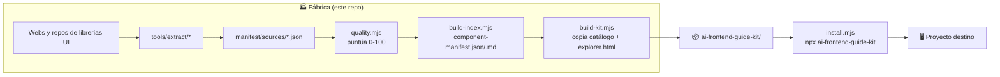
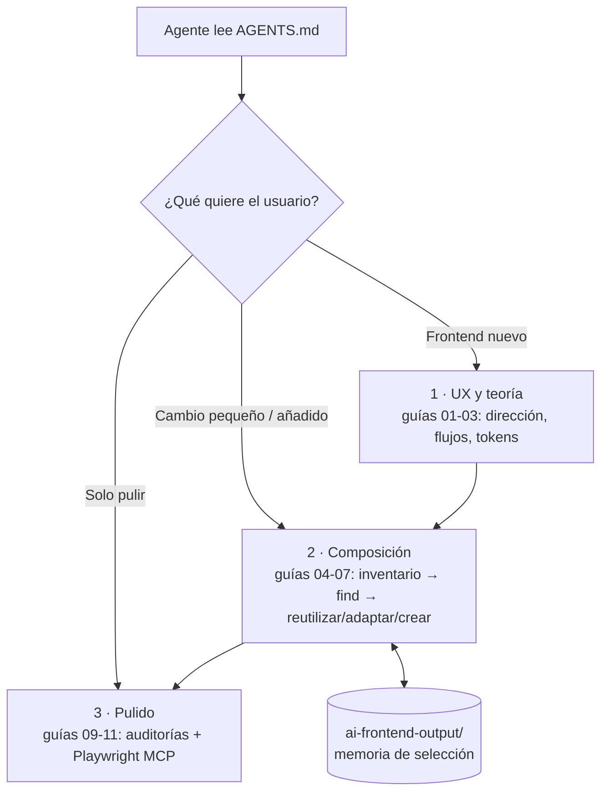
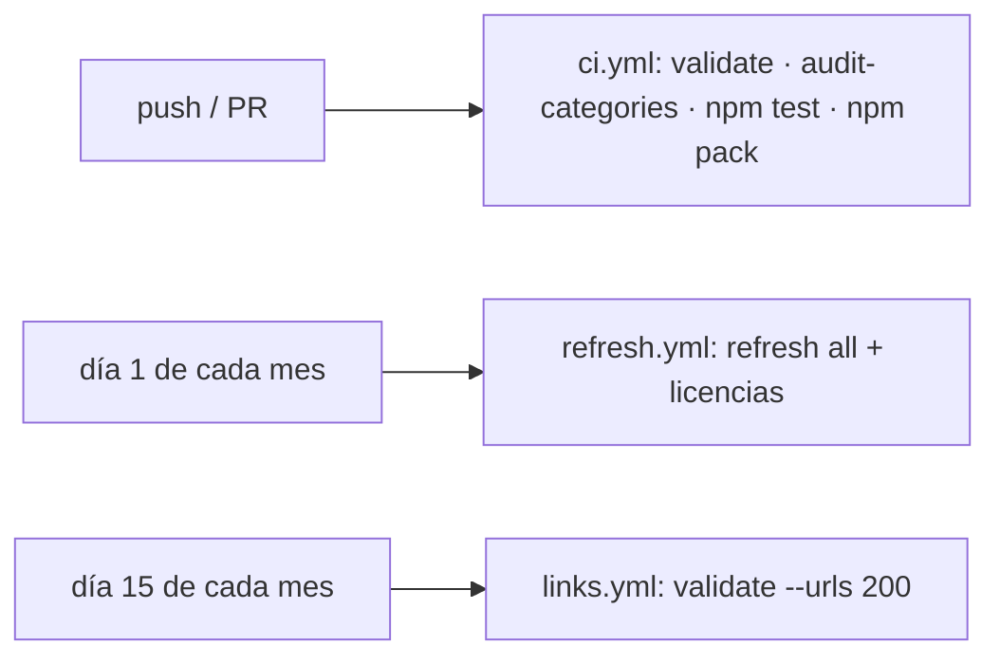

# Resumen de la aplicación (fuente de verdad)

> **Qué es:** catálogo de componentes UI reutilizables + kit guiado para que agentes de IA construyan frontends reutilizando antes de crear.
> **Versión:** 1.3.0 · **Cifras:** 34 fuentes · 4287 entradas · 21 categorías · 19 skills propias
>
> 🔁 **Mantenlo al día:** actualiza este archivo en el mismo commit que añada, quite o cambie una funcionalidad.
> `npm test` falla si las cifras de arriba no coinciden con `manifest/component-manifest.json`.

## 1. Vista general

El repo tiene dos caras: la **fábrica** (genera el catálogo) y el **kit** (lo que se instala en otros proyectos).



## 2. Funcionalidades

| Funcionalidad | Qué hace | Cómo lo hace (archivo) |
|---|---|---|
| **Extracción** | Saca componentes de 34 librerías (shadcn, MUI, Radix, Magic UI…) | Un extractor por fuente en `tools/extract/`; `tools/refresh.mjs <id\|all>` |
| **Puntuación de calidad** | Nota 0-100 por entrada: licencia, esfuerzo de instalación, dependencias, mantenimiento | `tools/quality.mjs` (determinista) |
| **Índice del catálogo** | Índice ligero para agentes + guía legible | `tools/build-index.mjs` → `manifest/component-manifest.*` |
| **Validación** | Esquema, IDs únicos, coherencia del índice, muestreo de URLs | `tools/validate.mjs` (`--fixtures`, `--urls`) |
| **Licencias** | Contrasta la licencia declarada con el LICENSE del repo | `tools/check-licenses.mjs` → `license-report.md` |
| **Auditoría de categorías** | Detecta entradas mal clasificadas (falla si >3 %) | `tools/audit-categories.mjs --strict` |
| **Kit portable** | Sincroniza catálogo al kit y genera explorador offline | `tools/build-kit.mjs`, `tools/build-explorer.mjs` |
| **Instalador** | Copia el kit, añade el bloque que manda toda conversación de diseño al kit (`AGENTS.md` y `CLAUDE.md` si existe; se actualiza al reinstalar), instala skills y MCP | `install.mjs` (flags `--no-skills`, `--no-mcp`, `--with-laya`, `--target`) |
| **Búsqueda** | Filtra por texto, categoría, stack, licencia y calidad | `kit/tools/find.mjs` |
| **Ficha de componente** | Tarjeta completa con cómo instalarlo | `kit/tools/get.mjs <id>` |
| **Contexto del proyecto** | Resume stack, rutas y specs del proyecto destino | `kit/tools/context.mjs` → `REPO-CONTEXT.md` |
| **Memoria de selección** | Historial de decisiones y combinaciones reutilizables | `kit/tools/memory.mjs` → `ai-frontend-output/` |
| **Auditorías de pantalla** | Patrones engañosos, accesibilidad (axe/WCAG 2.2), rendimiento (Lighthouse) | `kit/tools/audit-honesty.mjs`, `audit-a11y.mjs`, `audit-perf.mjs` |
| **Mapa UX** | Diagrama Excalidraw de pantallas, offline | `kit/tools/excalidraw-mcp.mjs` + skill `ux-map` |
| **Ranking con Laya** (opcional) | Ordena preguntas, dirección de experiencia y candidatos con IA local | `kit/tools/laya_select.py` |
| **Skills de agente** | Flujo guiado, pulido final, mapa UX y 16 flujos UX (`flow-*`) | `skills/` (copiadas a `.agents/skills/`) |

`kit/` = `ai-frontend-guide-kit/`.

## 3. Flujo de trabajo del kit (en el proyecto destino)

Las fases son **puntos de entrada**: el agente pregunta primero qué quieres y entra donde toca.



**Regla de oro:** reutilizar > adaptar > crear desde cero.

## 4. Automatización (CI)



## 5. Mapa de carpetas

| Carpeta | Contenido |
|---|---|
| `manifest/` | Catálogo fuente (por fuente) e índice generado |
| `tools/` | Scripts de la fábrica |
| `ai-frontend-guide-kit/` | Kit distribuible: `AGENTS.md`, `guides/`, `catalog/`, `experience/`, `tools/` |
| `skills/` | Skills de agente propias y vendorizadas |
| `openspec/specs/` | Specs por capacidad (catálogo, kit, distribución, Laya, memoria, UX) |
| `tests/` | Tests con `node --test` |
| `examples/`, `media/` | Recorrido de ejemplo y vídeo explicativo |

## 6. Comandos clave

```bash
npm run verify        # validar + construir kit + tests (lo que hay que pasar antes de commit)
node tools/refresh.mjs all   # reextraer todas las fuentes
npm run build:kit     # regenerar el kit
```
